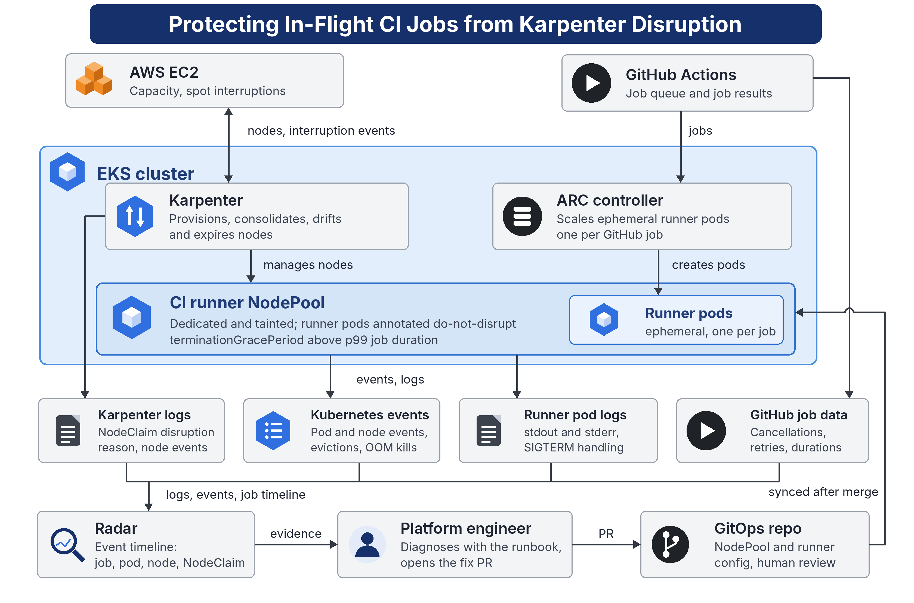

# Protecting In-Flight CI Jobs from Karpenter Disruption

Keep Karpenter's elastic-node savings without killing GitHub Actions jobs mid-run.
Self-hosted ARC runners get a dedicated Karpenter NodePool, `do-not-disrupt` on every runner pod,
and a `terminationGracePeriod` longer than the longest job. Radar keeps the evidence, and every
fix ships as a reviewed GitOps change.

The goal is not zero node disruption. It is disruption that is intentional, observable, and economically justified.



## Use case

Protect in-flight GitHub Actions jobs on self-hosted ARC runners in EKS from Karpenter node
disruption, while keeping the cost savings of elastic nodes.

**Stack:** Amazon EKS · Actions Runner Controller (runner scale sets) · Karpenter v1 · Radar · GitOps

## Problem

Karpenter removes nodes to save money (consolidation) or keep them current (drift, expiration).
On spot capacity, AWS can also reclaim them. When the node goes, the runner pod and its job go with
it: the job fails, retries, or needs manual recovery.

Teams usually can't tell whether a failure was Karpenter, the application, an OOM kill, or a user
cancellation. So they over-protect nodes and lose the savings, or under-protect them and lose builds.
A common mistake is relying on `do-not-disrupt` alone: it does not stop expiration's forced drain
past the grace period, or spot interruptions.

## How it works

| Stage | What happens |
| --- | --- |
| **Protect** | CI runs on a dedicated, tainted NodePool. Runner pods carry `karpenter.sh/do-not-disrupt`, which blocks consolidation and drift and holds a draining node until the job ends. `terminationGracePeriod` sits above p99 job duration, so an expiring node waits for the job. Long or deploy-critical jobs use on-demand capacity. |
| **Observe** | Karpenter logs (with the NodeClaim disruption reason), Kubernetes events, runner pod logs and GitHub job data are kept and correlated on Radar's event timeline. |
| **Diagnose** | When a job fails, an engineer follows the [diagnosis runbook](docs/runbook-diagnosis.md): did a node terminate during the job window, which disruption path was it, which protections were in place. `scripts/correlate-job.sh` gathers the evidence for one runner. |
| **Fix** | The change that matches the path (annotation or budget for voluntary disruption, grace period for expiration, on-demand for spot) goes in as a reviewed GitOps PR. |
| **Verify** | Job disruption rate and retry waste are tracked against a baseline, alongside consolidation savings and the cost of nodes held by protections. |

## Proven so far

On `ac-ws-dev-use2` (EKS 1.36, Karpenter 1.14.1, ARC 0.14.2), a 10-minute job survived a forced
drain started 2 minutes in. Karpenter held the node for 8 min 40 s until the job finished, then
removed it. Details: [docs/testing.md](docs/testing.md). Evidence (Radar events table and command logs):
[docs/evidence/2026-10-16-forced-drain](docs/evidence/2026-10-16-forced-drain/README.md).

## Repository layout

```
docs/
  architecture/          architecture.png and the script that renders it
  design.md              disruption paths, controls, recommended design, metrics, risks
  implementation-guide.md  step-by-step rollout, Steps 0 to 6
  runbook-diagnosis.md   how to decide whether Karpenter caused a failed job
  testing.md             disruption test plan and recorded results
  evidence/              Radar event tables and command logs per test run
karpenter/
  helm/values.yaml       controller values
  ec2nodeclass-ci.yaml   shared node class, pinned AMI
  nodepool-ci-ondemand.yaml
  nodepool-ci-spot.yaml
arc/
  arc-runner-set-values.yaml       runner set on the on-demand pool, with do-not-disrupt
  arc-runner-set-spot-values.yaml  optional spot runner set
iam/pod-identity-trust.json        trust policy for the Karpenter controller role
scripts/                 install, apply, verify, evidence and test helpers
examples/workflows/      disruption-test workflow to copy into the runner repo
```

## Quick start

Prerequisites: `aws`, `kubectl`, `helm`, `envsubst` and (for the baseline) `gh`, with access to the cluster.
Settings live in [`scripts/env.sh`](scripts/env.sh); override any of them with environment variables.

```bash
scripts/01-install-karpenter.sh     # IAM, queue, access entry, Pod Identity, tags, Helm install
scripts/02-apply-ci-pools.sh        # ci EC2NodeClass + ci-ondemand pool (add --with-spot for ci-spot)
scripts/03-upgrade-arc.sh           # runner set onto the CI pool with do-not-disrupt
scripts/verify.sh                   # PASS/FAIL health check
```

Then copy [`examples/workflows/disruption-test.yml`](examples/workflows/disruption-test.yml) into the
runner repository and run the tests in [docs/testing.md](docs/testing.md).

When a job fails:

```bash
scripts/correlate-job.sh <runner-pod-name>   # within about an hour; use Radar for older jobs
scripts/capture-evidence.sh incident-name    # snapshot before events expire
```

## Success metrics

| Metric | Definition |
| --- | --- |
| Job disruption rate | % of jobs failed or cancelled with a confirmed node termination in their window |
| Retry waste | Runner minutes spent on retries attributable to node disruption |
| Consolidation savings retained | Consolidation rate per runner node-hour after the change, against the baseline |
| Protection cost | Node-hours held by `DisruptionBlocked` or by draining past expiration |
| Detection time | Time from interruption to evidence-backed diagnosis |
| False attribution rate | Incidents blamed on Karpenter that the evidence shows had another cause |

See [docs/design.md](docs/design.md) for the reasoning behind each control and its limits.
