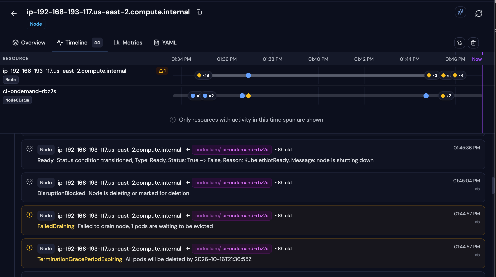
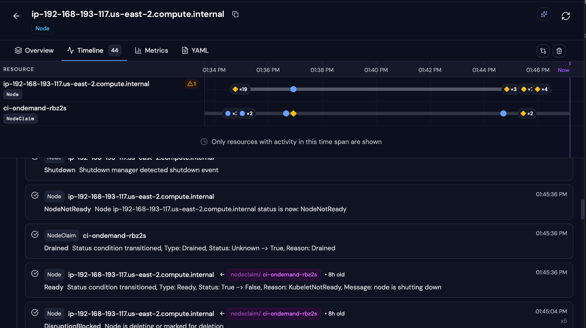
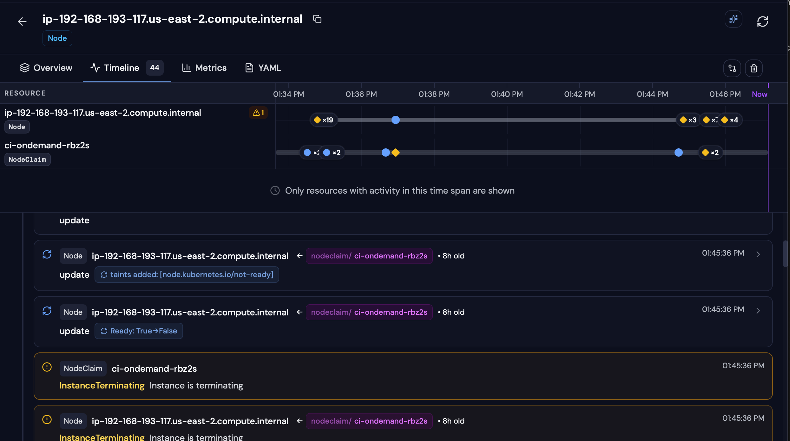

# Evidence: forced drain test, 2026-10-16

Cluster `ac-ws-dev-use2` (EKS 1.36.4, us-east-2), Karpenter 1.14.1, ARC 0.14.2.
Runner pod `arc-runner-set-fkvcg-runner-cq7vs` ran a 10-minute job on NodeClaim `ci-ondemand-rbz2s`
(c6a.large, on-demand, us-east-2c, node `ip-192-168-193-117`). The NodeClaim was deleted 2 minutes into the job.

**Verdict: NO IMPACT.** The `do-not-disrupt` annotation held the node for **8 min 40 s** (13:36:56 to 13:45:36)
until the job finished. Then the node drained and the instance terminated. Diagnosis method: [runbook](../../runbook-diagnosis.md).

## Files

| File | Contents |
| --- | --- |
| [radar-events.csv](radar-events.csv) | All 44 Radar events for the node and NodeClaim, oldest first |
| [radar-events-raw.txt](radar-events-raw.txt) | Radar timeline export as captured (newest first) |
| [screenshots/](screenshots/) | Radar timeline screenshots of the node and NodeClaim |
| [logs/01-cluster-prechecks.log](logs/01-cluster-prechecks.log) | Cluster state before the install: nodes, capacity, auth mode, security groups, DNS |
| [logs/02-karpenter-install.log](logs/02-karpenter-install.log) | CloudFormation, IAM, access entry, Pod Identity, tags, Helm install, health |
| [logs/03-ci-pool-and-runner-set.log](logs/03-ci-pool-and-runner-set.log) | EC2NodeClass (including the placeholder-AMI mistake), NodePool, runner set upgrade |
| [logs/04-forced-drain-test.log](logs/04-forced-drain-test.log) | Pod and NodeClaim watches, annotation check, drain, events, cleanup |

AWS account IDs are masked as `<ACCOUNT_ID>` in the logs.

## Key events

| Time (Phoenix) | Object | Event | What it proves |
| --- | --- | --- | --- |
| 13:34:39 | NodeClaim | Launched (c6a.large, on-demand) | Karpenter provisioned on demand for the pending runner |
| 13:35:11 | NodeClaim | Ready | Node ready 32 s after launch; runner `Running` at 13:35:26 |
| 13:36:40 | NodeClaim | **DisruptionBlocked**: Pod has "karpenter.sh/do-not-disrupt" annotation (Pod=arc-runners/arc-runner-set-fkvcg-runner-cq7vs) | The protection is on this pod |
| 13:36:56 | NodeClaim | **TerminationGracePeriodExpiring**: All pods will be deleted by 2026-10-16T21:36:55Z | Forced drain started; deadline 1 hour out |
| 13:36:56 | Node | taint `karpenter.sh/disrupted` added | Node cordoned; nothing new schedules there |
| 13:44:57 | Node | **FailedDraining**: 1 pods are waiting to be evicted (×5) | Karpenter kept retrying and kept waiting for the job |
| 13:45:36 | NodeClaim | **Drained**, then InstanceTerminating | Drain completed only after the job ended |
| 13:46:10 | Node | RemovingNode | Node gone; instance `i-007084a522299f95d` terminated |

## Radar screenshots

Radar's timeline for node `ip-192-168-193-117` and NodeClaim `ci-ondemand-rbz2s` (44 events, 13:34 to 13:46).
The gap in the node's lane between about 13:37 and 13:44 is the job running on a cordoned node that Karpenter
could not drain.

**1. Held for the job (13:44:57 to 13:45:04).** `TerminationGracePeriodExpiring` and `FailedDraining` (×5 each):
the drain is waiting on the protected runner pod. `DisruptionBlocked`: node is deleting or marked for deletion.

**2. Job done, node drained (13:45:36).** `Drained` on the NodeClaim, then the node reports `NodeNotReady`
and a shutdown event.

**3. Instance terminating (13:45:36).** `InstanceTerminating` on the NodeClaim and node, `Ready: True→False`,
and the `node.kubernetes.io/not-ready` taint.

## All Radar events

Phases: 1 launch, 2 boot and join, 3 protection proven, 4 forced drain starts, 5 held for the job,
6 job done and drained, 7 cleanup. Rows marked *routine* are normal noise to ignore during diagnosis.
The first event has no time in the Radar export; it precedes 13:34:39.

| # | Time (Phoenix) | Phase | Kind | Object | Reason | Message | Count | Note |
| --- | --- | --- | --- | --- | --- | --- | --- | --- |
| 1 | before 01:34:39 PM | 1 Launch | NodeClaim | ci-ondemand-rbz2s | Launched | Status condition transitioned, Type: Launched, Status: Unknown -> True, Reason: Launched | 1 |  |
| 2 | 01:34:39 PM | 1 Launch | NodeClaim | ci-ondemand-rbz2s | DisruptionBlocked | Nodeclaim does not have an associated node | 1 | routine |
| 3 | 01:34:50 PM | 2 Boot and join | Node | ip-192-168-193-117 | NodeAllocatableEnforced | Updated Node Allocatable limit across pods | 1 |  |
| 4 | 01:34:50 PM | 2 Boot and join | Node | ip-192-168-193-117 | Starting | Starting kubelet. | 1 |  |
| 5 | 01:34:50 PM | 2 Boot and join | Node | ip-192-168-193-117 | InvalidDiskCapacity | invalid capacity 0 on image filesystem | 1 | routine |
| 6 | 01:34:51 PM | 2 Boot and join | Node | ip-192-168-193-117 | NodeHasSufficientPID | Node ip-192-168-193-117.us-east-2.compute.internal status is now: NodeHasSufficientPID | 3 |  |
| 7 | 01:34:51 PM | 2 Boot and join | Node | ip-192-168-193-117 | NodeHasSufficientMemory | Node ip-192-168-193-117.us-east-2.compute.internal status is now: NodeHasSufficientMemory | 3 |  |
| 8 | 01:34:51 PM | 2 Boot and join | Node | ip-192-168-193-117 | NodeHasNoDiskPressure | Node ip-192-168-193-117.us-east-2.compute.internal status is now: NodeHasNoDiskPressure | 3 |  |
| 9 | 01:34:54 PM | 2 Boot and join | NodeClaim | ci-ondemand-rbz2s | Registered | Status condition transitioned, Type: Registered, Status: Unknown -> True, Reason: Registered | 1 |  |
| 10 | 01:34:54 PM | 2 Boot and join | Node | ip-192-168-193-117 | Synced | Node synced successfully | 1 |  |
| 11 | 01:34:54 PM | 2 Boot and join | Node | ip-192-168-193-117 | add |  | 1 |  |
| 12 | 01:34:54 PM | 2 Boot and join | Node | ip-192-168-193-117 | update | taints removed: [karpenter.sh/unregistered] | 1 |  |
| 13 | 01:34:54 PM | 2 Boot and join | Node | ip-192-168-193-117 | update | taints removed: [node.cloudprovider.kubernetes.io/uninitialized] | 1 |  |
| 14 | 01:34:55 PM | 2 Boot and join | Node | ip-192-168-193-117 | RegisteredNode | Node ip-192-168-193-117.us-east-2.compute.internal event: Registered Node ip-192-168-193-117.us-east-2.compute.internal in Controller | 1 |  |
| 15 | 01:34:55 PM | 2 Boot and join | Node | ip-192-168-193-117 | update |  | 1 |  |
| 16 | 01:35:00 PM | 2 Boot and join | Node | ip-192-168-193-117 | DisruptionBlocked | Node isn't initialized | 1 | routine |
| 17 | 01:35:02 PM | 2 Boot and join | Node | ip-192-168-193-117 | Starting |  | 1 |  |
| 18 | 01:35:09 PM | 2 Boot and join | Node | ip-192-168-193-117 | NodeReady | Node ip-192-168-193-117.us-east-2.compute.internal status is now: NodeReady | 1 |  |
| 19 | 01:35:09 PM | 2 Boot and join | Node | ip-192-168-193-117 | Ready | Status condition transitioned, Type: Ready, Status: False -> True, Reason: KubeletReady, Message: kubelet is posting ready status | 1 |  |
| 20 | 01:35:09 PM | 2 Boot and join | Node | ip-192-168-193-117 | update | Ready: False→True | 1 |  |
| 21 | 01:35:09 PM | 2 Boot and join | Node | ip-192-168-193-117 | update |  | 1 |  |
| 22 | 01:35:10 PM | 2 Boot and join | Node | ip-192-168-193-117 | update | taints removed: [node.kubernetes.io/not-ready] | 1 |  |
| 23 | 01:35:11 PM | 2 Boot and join | NodeClaim | ci-ondemand-rbz2s | Initialized | Status condition transitioned, Type: Initialized, Status: Unknown -> True, Reason: Initialized | 1 |  |
| 24 | 01:35:11 PM | 2 Boot and join | NodeClaim | ci-ondemand-rbz2s | Ready | Status condition transitioned, Type: Ready, Status: Unknown -> True, Reason: Ready | 1 |  |
| 25 | 01:36:40 PM | 3 Protection proven | NodeClaim | ci-ondemand-rbz2s | **DisruptionBlocked** | Pod has "karpenter.sh/do-not-disrupt" annotation (Pod=arc-runners/arc-runner-set-fkvcg-runner-cq7vs) | 1 | key |
| 26 | 01:36:56 PM | 4 Forced drain starts | NodeClaim | ci-ondemand-rbz2s | **TerminationGracePeriodExpiring** | All pods will be deleted by 2026-10-16T21:36:55Z | 1 | key |
| 27 | 01:36:56 PM | 4 Forced drain starts | Node | ip-192-168-193-117 | **update** | taints added: [karpenter.sh/disrupted] | 1 | key |
| 28 | 01:44:43 PM | 5 Held for the job | NodeClaim | ci-ondemand-rbz2s | DisruptionBlocked | Node is deleting or marked for deletion | 4 |  |
| 29 | 01:44:57 PM | 5 Held for the job | Node | ip-192-168-193-117 | TerminationGracePeriodExpiring | All pods will be deleted by 2026-10-16T21:36:55Z | 5 |  |
| 30 | 01:44:57 PM | 5 Held for the job | Node | ip-192-168-193-117 | **FailedDraining** | Failed to drain node, 1 pods are waiting to be evicted | 5 | key |
| 31 | 01:45:04 PM | 5 Held for the job | Node | ip-192-168-193-117 | DisruptionBlocked | Node is deleting or marked for deletion | 5 |  |
| 32 | 01:45:36 PM | 6 Job done, drained | Node | ip-192-168-193-117 | Ready | Status condition transitioned, Type: Ready, Status: True -> False, Reason: KubeletNotReady, Message: node is shutting down | 1 |  |
| 33 | 01:45:36 PM | 6 Job done, drained | NodeClaim | ci-ondemand-rbz2s | **Drained** | Status condition transitioned, Type: Drained, Status: Unknown -> True, Reason: Drained | 1 | key |
| 34 | 01:45:36 PM | 6 Job done, drained | Node | ip-192-168-193-117 | NodeNotReady | Node ip-192-168-193-117.us-east-2.compute.internal status is now: NodeNotReady | 1 |  |
| 35 | 01:45:36 PM | 6 Job done, drained | Node | ip-192-168-193-117 | Shutdown | Shutdown manager detected shutdown event | 1 |  |
| 36 | 01:45:36 PM | 6 Job done, drained | Node | ip-192-168-193-117 | InstanceTerminating | Instance is terminating | 1 |  |
| 37 | 01:45:36 PM | 6 Job done, drained | NodeClaim | ci-ondemand-rbz2s | **InstanceTerminating** | Instance is terminating | 1 | key |
| 38 | 01:45:36 PM | 6 Job done, drained | Node | ip-192-168-193-117 | update | Ready: True→False | 1 |  |
| 39 | 01:45:36 PM | 6 Job done, drained | Node | ip-192-168-193-117 | update | taints added: [node.kubernetes.io/not-ready] | 1 |  |
| 40 | 01:45:41 PM | 6 Job done, drained | Node | ip-192-168-193-117 | update |  | 1 |  |
| 41 | 01:46:07 PM | 7 Cleanup | Node | ip-192-168-193-117 | DeletingNode | Deleting node ip-192-168-193-117.us-east-2.compute.internal because it does not exist in the cloud provider | 1 |  |
| 42 | 01:46:07 PM | 7 Cleanup | Node | ip-192-168-193-117 | DeletingNodeFailed | Failed deleting node ip-192-168-193-117.us-east-2.compute.internal: nodes "ip-192-168-193-117.us-east-2.compute.internal" not found | 1 | routine |
| 43 | 01:46:07 PM | 7 Cleanup | Node | ip-192-168-193-117 | delete |  | 1 |  |
| 44 | 01:46:10 PM | 7 Cleanup | Node | ip-192-168-193-117 | **RemovingNode** | Node ip-192-168-193-117.us-east-2.compute.internal event: Removing Node ip-192-168-193-117.us-east-2.compute.internal from Controller | 1 | key |
